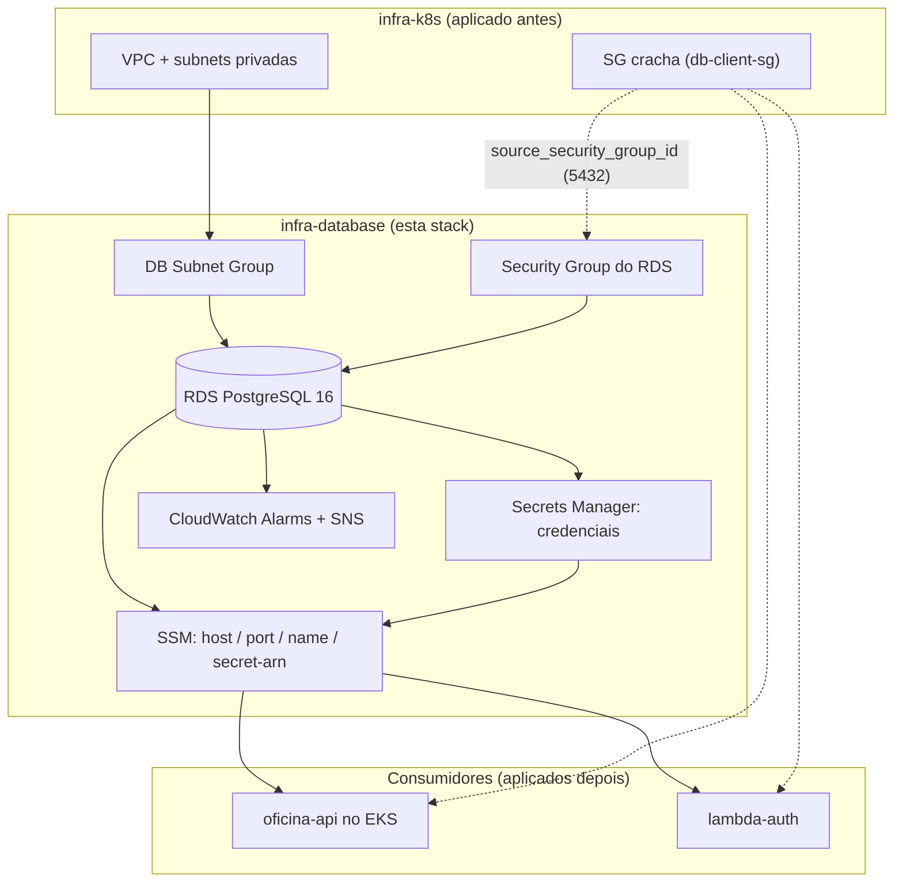

# infra-database

Stack Terraform do banco de dados gerenciado da `oficina-api` — Fase 3 do Tech
Challenge FIAP PosTech (migração para AWS). Provisiona uma instância **RDS
PostgreSQL 16**, seu Security Group, credenciais no **Secrets Manager**,
alarmes de **CloudWatch** e publica o endereço de conexão no **SSM Parameter
Store** para as demais stacks (`infra-k8s`, `lambda-auth`) consumirem.

## Propósito

A aplicação `oficina-api` (EKS, via `infra-k8s`) e a Lambda de autenticação
(`lambda-auth`) precisam de um único banco compartilhado. Este repositório é
o dono do ciclo de vida do banco: cria a instância, gera e guarda a senha, e
publica os dados de conexão para quem precisar — sem que nenhuma outra stack
manipule o RDS diretamente.

## Tecnologias

| Item | Escolha |
|---|---|
| IaC | Terraform `>= 1.6.0`, provider `hashicorp/aws ~> 5.70` |
| Banco | Amazon RDS PostgreSQL `16.4` |
| Credenciais | AWS Secrets Manager (senha gerada por `random_password`) |
| Observabilidade | CloudWatch Metric Alarms + SNS (e-mail opcional) |
| Contrato entre stacks | AWS SSM Parameter Store (`/oficina/<env>/...`) |
| Backend do estado | S3 parcial (`terraform init -backend-config=...` na pipeline) |
| CI/CD | GitHub Actions (`fmt`/`validate` em PR, `plan`/`apply` via OIDC no push) |

Justificativa detalhada da escolha (PostgreSQL gerenciado vs. DynamoDB vs.
Aurora Serverless) e o diagrama entidade-relacionamento completo estão em
[`docs/modelo-dados.md`](docs/modelo-dados.md).

## Diagrama da stack



O SG "cracha" (`db-client-sg-id`, publicado por `infra-k8s`) não tem nenhuma
regra própria — nós do EKS e a Lambda apenas o vestem. O Security Group do
RDS libera 5432 apenas para quem veste esse SG. Isso evita uma dependência
circular: esta stack não precisa saber quais recursos (EKS, Lambda) existem,
e as stacks consumidoras não precisam saber o SG do banco.

## Ordem de aplicação

```
infra-k8s  ->  infra-database (esta stack)  ->  lambda-auth
```

`infra-k8s` publica a rede (`vpc-id`, `private-subnet-ids`, `db-client-sg-id`)
que esta stack consome via `data "aws_ssm_parameter"`. Só depois de aplicada,
`infra-database` publica `host`/`port`/`name`/`secret-arn`, que `lambda-auth`
(e o deployment da aplicação no EKS) consomem da mesma forma.

## Passos de execução

### Validação local (sem credenciais AWS)

```bash
cd infra-database/terraform
terraform fmt -check -recursive
terraform init -backend=false
terraform validate
```

### Deploy (via pipeline, com OIDC)

```bash
cd infra-database/terraform
terraform init \
  -backend-config="bucket=<TF_STATE_BUCKET>" \
  -backend-config="key=infra-database/<ambiente>/terraform.tfstate" \
  -backend-config="region=us-east-1" \
  -backend-config="dynamodb_table=<TF_LOCK_TABLE>" \
  -backend-config="encrypt=true"

terraform plan  -var-file=environments/<ambiente>.tfvars -out=tfplan
terraform apply -auto-approve tfplan
```

`<ambiente>` é `homolog` ou `prod`. O deploy real é feito pelo workflow
[`cd.yml`](.github/workflows/cd.yml) (branch `homolog` → ambiente `homolog`,
branch `main` → ambiente `prod`), autenticado por OIDC
(`AWS_DEPLOY_ROLE_ARN`), nunca com chave de acesso estática.

## Secrets e variables da pipeline

Configurados no GitHub (repositório e/ou por Environment `homolog`/`prod`)
para o workflow [`cd.yml`](.github/workflows/cd.yml) funcionar:

| Nome | Tipo | O que quebra se estiver ausente |
|---|---|---|
| `AWS_DEPLOY_ROLE_ARN` | Secret | O passo "Credenciais AWS (OIDC)" falha ao assumir a role — nenhum comando Terraform seguinte consegue autenticar, o job para no `terraform init` |
| `TF_STATE_BUCKET` | Secret | `terraform init` falha (backend S3 sem bucket) — o deploy nem chega a ler o state |
| `TF_LOCK_TABLE` | Secret | `terraform init` falha (backend sem tabela de lock DynamoDB) |
| `AWS_REGION` | Variable | Opcional — sem ela, a pipeline usa `us-east-1` como padrão |

Esta stack não expõe nenhum secret opcional próprio: o RDS, o Secrets
Manager e os alarmes de CloudWatch são criados sem depender de credenciais
externas além da role de deploy acima.

## Outputs

| Output | Descrição |
|---|---|
| `db_endpoint` | `host:port` da instância RDS |
| `db_secret_arn` | ARN do segredo no Secrets Manager (usuário/senha/host/porta/dbname) |
| `db_security_group_id` | ID do Security Group do RDS |

## Parâmetros publicados no SSM

| Parâmetro | Valor |
|---|---|
| `/oficina/<env>/database/host` | `aws_db_instance.oficina.address` |
| `/oficina/<env>/database/port` | `5432` |
| `/oficina/<env>/database/name` | `oficina_db` |
| `/oficina/<env>/database/secret-arn` | ARN do segredo com as credenciais |

## Documentação da API (Swagger / Postman)

Este repositório não expõe API própria — provisiona apenas o banco
gerenciado consumido pela aplicação. A documentação interativa das rotas
que usam este banco é o Swagger da aplicação (`oficina-api`):

- Swagger UI: `https://<api_endpoint>/api/swagger-ui.html` (via API Gateway) ou `http://localhost:8080/api/swagger-ui.html` (local)
- OpenAPI JSON: `https://<api_endpoint>/api/v3/api-docs`

## Documentação complementar

- [`docs/modelo-dados.md`](docs/modelo-dados.md) — justificativa da escolha
  do banco, diagrama ER e ajustes de modelo aplicados via
  `oficina-api/.../V8__indices_e_constraints_fase3.sql`.
- [`docs/rfc/004-banco-de-dados.md`](https://github.com/olavowilke/soat-oficina-api/blob/main/docs/rfc/004-banco-de-dados.md) — RFC da escolha do banco gerenciado
- [`docs/adr/0005-contrato-entre-stacks-via-ssm.md`](https://github.com/olavowilke/soat-oficina-api/blob/main/docs/adr/0005-contrato-entre-stacks-via-ssm.md) — ADR do contrato entre stacks via SSM
- [`docs/arquitetura/componentes.md`](https://github.com/olavowilke/soat-oficina-api/blob/main/docs/arquitetura/componentes.md) — diagrama de componentes de todo o sistema

> A documentação compartilhada entre os 4 repositórios (`docs/`, na raiz)
> tem cópia canônica em [`soat-oficina-api`](https://github.com/olavowilke/soat-oficina-api) — este repositório referencia por link em vez de duplicar.
