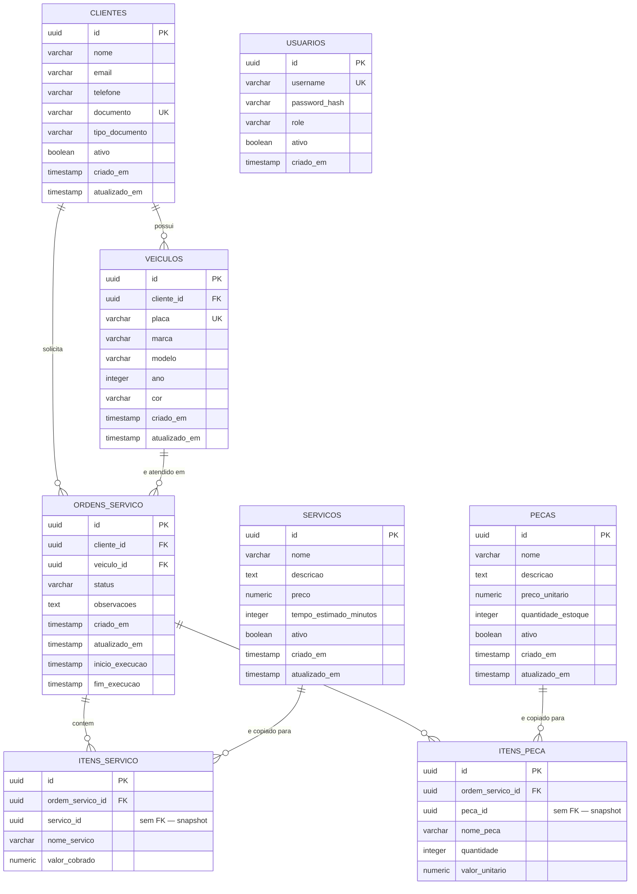

# Modelo de dados — oficina-api

Este documento cobre o que a especificacao da Fase 3 exige como entregavel formal:
a justificativa da escolha de banco de dados, o diagrama entidade-relacionamento
do schema real da aplicacao e os ajustes de modelagem aplicados na migration
`V8__indices_e_constraints_fase3.sql` (repositorio `oficina-api`).

## 1. Por que PostgreSQL gerenciado (RDS)

O dominio da oficina mecanica e fundamentalmente relacional: uma ordem de
servico agrega itens de servico e itens de peca, referencia um cliente e um
veiculo, e precisa ser escrita de forma atomica (criar a ordem e seus itens
numa unica transacao, sem estados intermediarios inconsistentes). A aplicacao
ja usa JPA/Hibernate com um schema normalizado e migrations versionadas via
Flyway (`V1` a `V7`). Trocar o motor de persistencia teria custo de reescrita
sem ganho real neste estagio do projeto. As alternativas consideradas:

| Criterio | DynamoDB | Aurora Serverless v2 | **RDS PostgreSQL (escolhido)** |
|---|---|---|---|
| Modelo de dados | Chave-valor/documento, single-table design | Relacional, wire-compatible com PostgreSQL | Relacional |
| Consultas | Otimizado para acesso por chave conhecida; joins e filtros ad-hoc (por status, por cliente, por periodo) exigem GSIs e desnormalizacao cuidadosa | SQL completo, joins nativos | SQL completo, joins nativos |
| Integridade referencial | Não há FKs nem transacoes multi-item nativas no mesmo nivel de um RDBMS | ACID, FKs, constraints | ACID, FKs, constraints |
| Esforco de migracao a partir do schema atual (JPA + Flyway) | Alto — redesenho completo do modelo de acesso | Nenhum — mesmo dialeto SQL, drop-in | Nenhum — mesmo dialeto SQL, drop-in |
| Escala/custo para o volume desta oficina (uma unidade, trafego moderado e previsivel) | Otimo para escala massiva/imprevisivel, mas isso não e o problema aqui | Escala automatica de capacidade, porem com modelo de cobranca por ACU e maior complexidade operacional | Custo previsivel, dimensionamento vertical simples (`instance_class`) e `max_allocated_storage` cobrem o crescimento esperado |
| Alta disponibilidade | Multi-region nativo (nao necessario aqui) | Multi-AZ | Multi-AZ (`multi_az = true` em prod) |

**Decisao:** RDS PostgreSQL "instance-based" (não Aurora). O dominio e as
consultas da aplicacao (filtrar ordens por status, por cliente, relatorios)
são relacionais por natureza e o schema ja existe e funciona com Postgres
puro. DynamoDB exigiria reescrever toda a camada de persistencia para um
ganho de escala que este projeto não demanda (YAGNI). Aurora Serverless v2
é uma alternativa razoavel para trafego muito imprevisivel, mas adiciona
complexidade de billing e operacao (Aurora Capacity Units) sem necessidade —
RDS `db.t3.micro`/`db.t3.medium` com armazenamento `gp3` autoscaling
(`allocated_storage` -> `max_allocated_storage`) e Multi-AZ em produção
atendem os requisitos de custo, simplicidade e disponibilidade da Fase 3.
Se o trafego crescer de forma imprevisivel no futuro, a migracao para Aurora
Serverless v2 e direta (mesmo dialeto), o que preserva essa opcao sem pagar
o custo dela agora.

## 2. Diagrama entidade-relacionamento

Reflete o schema real criado pelas migrations `V1`-`V7` de `oficina-api`
(8 tabelas), incluindo os ajustes adicionados por `V8` (marcados nas notas
abaixo do diagrama).

`USUARIOS` nao se relaciona com as demais tabelas: e a tabela de autenticacao
local da API (login/senha para os papeis internos), independente do cadastro
de clientes.

### Por que `itens_servico`/`itens_peca` não têm FK para `servicos`/`pecas`

Essa e uma decisao de modelagem deliberada, nao um erro: os itens guardam
`nome_servico`/`valor_cobrado` e `nome_peca`/`valor_unitario` como uma copia
("snapshot") do preco e do nome no momento em que o item foi adicionado a
ordem. Isso preserva o valor historico cobrado mesmo que o preco do servico
ou da peca mude depois. Uma FK aqui obrigaria a manter o registro de
`servicos`/`pecas` vivo indefinidamente e não traria beneficio, ja que a
tabela de itens não faz join de leitura com elas em tempo de consulta.

## 3. Ajustes de modelo aplicados (`V8__indices_e_constraints_fase3.sql`)

A revisao do schema real (V1-V7) contra o modelo idealizado identificou os
seguintes gaps, corrigidos na migration `V8`:

| Ajuste | Situacao antes de V8 | Acao em V8 |
|---|---|---|
| `idx_ordens_servico_status` | Inexistente — consultas por status (fila de atendimento) faziam sequential scan | Criado |
| `idx_ordens_servico_cliente` | Inexistente | Criado em `ordens_servico(cliente_id)` |
| `idx_ordens_servico_veiculo` | Inexistente | Criado em `ordens_servico(veiculo_id)` — acompanha a FK nova abaixo (não estava na lista original do plano, mas e o mesmo raciocinio do indice de `cliente_id`: toda FK nova ganha indice de suporte) |
| `idx_veiculos_cliente` | **Ja existia** desde `V3` como `idx_veiculos_cliente_id` | Nenhuma acao — o indice ja cobre a coluna; documentado aqui para deixar claro que nao e uma lacuna |
| `idx_itens_servico_ordem` / `idx_itens_peca_ordem` | Inexistentes — joins de uma ordem com seus itens dependiam de sequential scan | Criados em `itens_servico(ordem_servico_id)` e `itens_peca(ordem_servico_id)` |
| FK `veiculos.cliente_id -> clientes(id)` | **Ja existia** desde `V3` (`REFERENCES clientes(id)`) | Nenhuma acao |
| FK `ordens_servico.cliente_id -> clientes(id)` | Inexistente — coluna `NOT NULL` sem `REFERENCES` | Adicionada |
| FK `ordens_servico.veiculo_id -> veiculos(id)` | Inexistente — coluna `NOT NULL` sem `REFERENCES` | Adicionada |
| `CHECK` de valores/quantidades positivos | Inexistentes em `servicos.preco`, `servicos.tempo_estimado_minutos`, `pecas.preco_unitario`, `pecas.quantidade_estoque`, `itens_peca.quantidade`, `itens_peca.valor_unitario`, `itens_servico.valor_cobrado` | Adicionados (ver migration para os limites exatos de cada coluna) |

> Nota: o plano original desta tarefa listava `idx_veiculos_cliente` e a FK de
> `veiculos.cliente_id` como ajustes pendentes. A leitura das migrations reais
> mostrou que ambos ja existem desde `V3__create_veiculos_table.sql`. A tabela
> acima reflete o estado real verificado, não a lista original de memoria.
